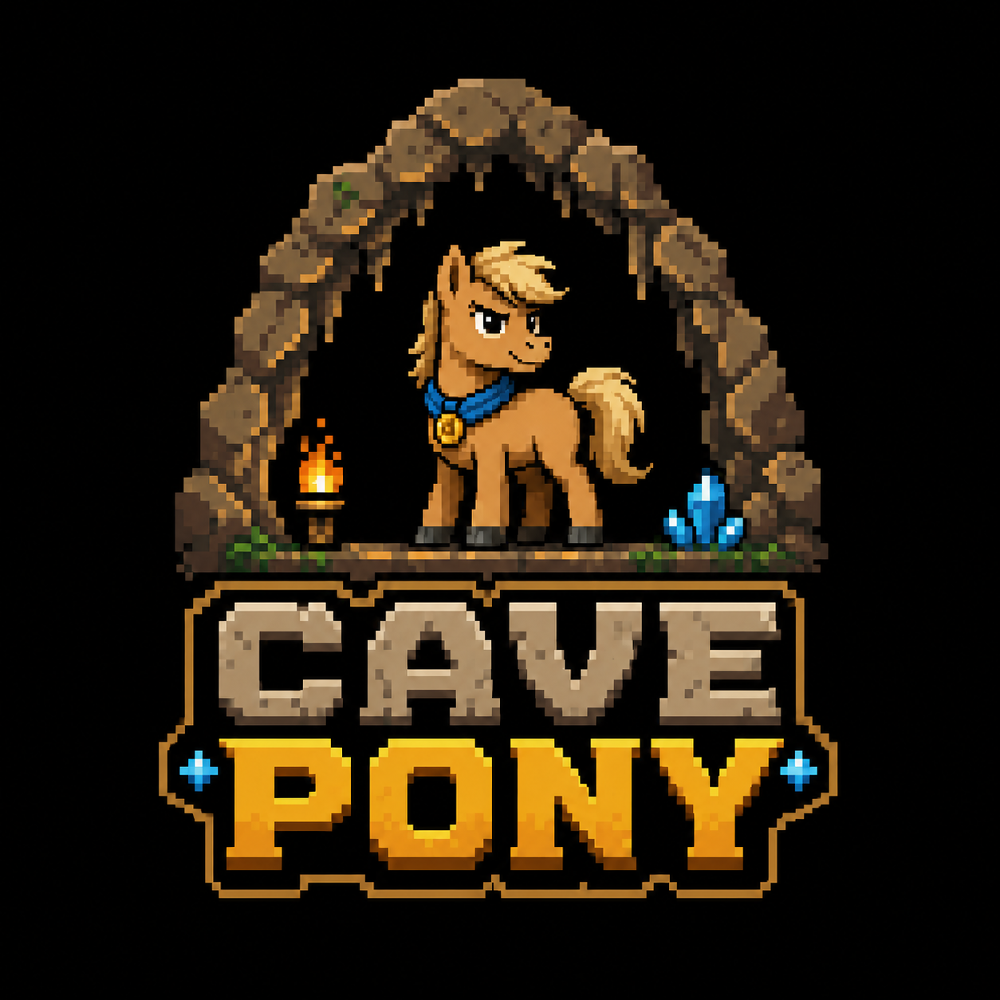

<p align="center">
  
</p>

<h1 align="center">Cave Pony</h1>

<p align="center"><strong>Write less code. Say less. Never fake proof.</strong></p>

<p align="center">
  <a href="https://github.com/wilfgrainger/cave-pony/actions/workflows/ci.yml"></a>
  <a href="LICENSE"></a>
  
</p>

[Caveman](https://github.com/JuliusBrussee/caveman) makes your agent talk less. [Ponytail](https://github.com/DietrichGebert/ponytail) makes it build less. Cave Pony does both in **one ~350-word skill**, and adds one rule neither has: *never say a check passed unless it ran.*

```bash
npx skills add wilfgrainger/cave-pony
```

Then say `/cave-pony` in Claude Code, or `$cave-pony` in Codex. Say `stop cave-pony` to turn it off.

## What it does

| | Normal agent | Cave Pony |
|---|---|---|
| "Make sure `slugify` lowercases" (it already does) | Adds a redundant `.lower()` and a test file | Changes nothing. "Already lowercases: `title.lower()`, line 5." |
| "Dedupe a list, keep order" | 19-line loop with a `seen` set and a docstring essay | `return list(dict.fromkeys(items))` |
| "Simplify this messy validator" | Sometimes drops a check while tidying | Shorter code, every rejection kept |
| Final report | Three paragraphs and "let me know if…" | `Done:` / `Proof:` / `Risk:` lines, only the ones that apply |

The whole contract is [`skills/cave-pony/SKILL.md`](skills/cave-pony/SKILL.md). Read it in a minute.

## Does it work?

Measured, not claimed. [`eval/`](eval/) runs the same 8 tasks through headless Claude Code with no skill, Caveman, Ponytail, both stacked, and Cave Pony. It scores hidden-test correctness first, then diff size, reply length and cost.

<!-- results -->
Results are pending from the first full run.
<!-- /results -->

Reproduce: `make eval` (about $3 for 120 runs). Eval tasks where Cave Pony loses are the most welcome contribution. See [CONTRIBUTING](CONTRIBUTING.md).

## Rules it never breaks

It never cuts input validation, auth, secrets handling, error handling that prevents data loss, or accessibility. Anything irreversible (delete, reset, force-push, drop, migrate) gets full plain sentences. Commits, docs and code comments use normal grammar.

## Credits

Built on ideas from Caveman and Ponytail. It is independently written and not endorsed by either project; see [Third-party notices](THIRD_PARTY_NOTICES.md). The previous, longer 0.1.x contract lives at tag [`v0.1.1`](https://github.com/wilfgrainger/cave-pony/tree/v0.1.1). MIT licensed.
